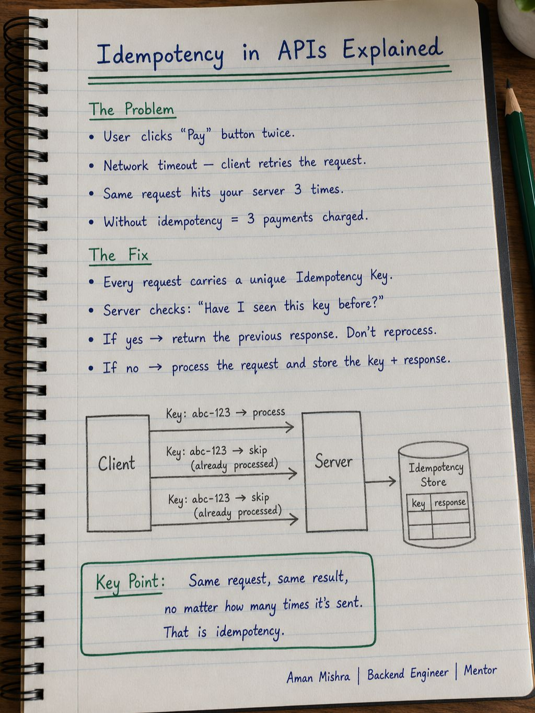

**English** · [မြန်မာ](README.my.md)

# Lab: inventory — two users, one item left

Alice and Bob both click "Buy" on the last sneaker (`stock = 1`). Exactly one order must succeed;
stock ends at `0`, never `-1`.

**Step 1 ✅** one user creates an order + idempotency · **Step 2** two users at once (next)
UI: `http://localhost:5173/labs/inventory/idempotency` · Postman: [`postman/`](postman/)

## 1. Idempotency

<a href="../../../../web/src/assets/references/idempotency/idempotency-theory.jpeg">
  
</a>

**Problem.** Double-click, or a lost response (timeout) → the client retries → without protection,
every retry is another order and another charge. `POST` isn't idempotent by nature.

**Fix.** The client sends one **idempotency key per purchase attempt** and re-sends the same key
on retry. The server: seen this key? → return the first result, do nothing. New key → process it.

The key means *one attempt*, not *one product* — buying the same sneaker again later uses a new key and works.

<sub>Diagram: Aman Mishra</sub><br clear="right">

**In code**

| | what | where |
|---|---|---|
| Client | `crypto.randomUUID()` per attempt, reused on retry (kept in `localStorage`) | `apps/web/src/labs/InventoryLab.tsx` |
| Service | key already used by this user → return that order, skip the purchase | [`inventory.service.ts#L78-L88`](inventory.service.ts#L78-L88) |
| Controller | new → **201**, replay → **200** | [`inventory.controller.ts#L45-L46`](inventory.controller.ts#L45-L46) |
| DB | `UNIQUE (user_id, idempotency_key)` — last line of defence | [`order.entity.ts#L25`](entities/order.entity.ts#L25) |

```ts
// inventory.service.ts — runs before stock is touched, inside the order transaction
if (dto.idempotencyKey) {
  const existing = await em.findOne(OrderEntity, { where: { userId, idempotencyKey: dto.idempotencyKey } });
  if (existing) return { order: existing, created: false };   // replay → no side effects
}
```

The key is saved in the same transaction as the stock decrement and the order — all or nothing.
(The diagram uses a separate *Idempotency Store*; here the key lives on the `orders` row.)

**Try it**

```bash
curl -s -X POST localhost:3000/api/inventory/dev/reset > /dev/null
for i in 1 2 3; do
  curl -s -o /dev/null -w "%{http_code}\n" -X POST localhost:3000/api/inventory/orders \
    -H 'Content-Type: application/json' -H 'X-User-Id: 1' \
    -d '{"productId":1,"quantity":1,"idempotencyKey":"abc-123"}'
done   # → 201, 200, 200
```

**Limits** (production adds these)
- Same key sent **concurrently** → the second hits the UNIQUE index → 500 (still one order). Fix: catch `ER_DUP_ENTRY`.
- Key lost (reinstall, other device) → a new order. Fix: server-issued checkout id (`PENDING` → `confirm`).
- Same key, different body → old order returned. Fix: store a body hash, reply 422.

**Interview Qs**
- Idempotent methods? `GET`, `PUT`, `DELETE`. Not `POST`/`PATCH` → they need a key.
- Why a DB constraint if code checks? The code check is read-then-write; concurrent requests can both pass.
- Does it stop two *users* racing for the last item? No — that's concurrency control (step 2).

## 2. API

Caller = `X-User-Id` header (1 Alice, 2 Bob) until the auth step.

| | path | result |
|---|---|---|
| GET | `/api/inventory/products` | products with `stock`, `version` |
| POST | `/api/inventory/orders` | `{ productId, quantity, idempotencyKey? }` → 201 new · 200 replay |
| GET | `/api/inventory/orders` | caller's orders |
| POST | `/api/inventory/dev/reset` | dev only: clear orders, restore stock |

Errors: 401 no user · 400 bad body · 404 unknown user/product · 409 insufficient stock.

## 3. Order flow (step 1)

[`createOrder`](inventory.service.ts#L67-L146), one transaction: user? → key seen? → **read** stock →
**check** in JS → **write** new stock → insert order + item (price snapshot).

⚠️ Read → check → write with no lock: fine for one user, **broken for two at once** (both read `1`,
both write `0`). On purpose — step 2 fixes it. Money is `DECIMAL`, totals in integer cents ([`money.ts`](money.ts)).

## 4. Schema

```
users 1──* orders 1──* order_items *──1 products
```

- `orders`: `UNIQUE(user_id, idempotency_key)` · `products`: `stock`, `version` (optimistic lock)
- CHECK `stock >= 0`, `quantity > 0`, `price >= 0`; FKs `RESTRICT`
- TypeORM ignores `@Check` on MySQL → CHECKs are added by `sql/seed.sql`

## 5. Run it

```bash
./scripts/db.sh up mysql      # + DB_DRIVER=mysql in apps/api/.env
npm run dev:api               # creates the tables
npm run db:seed:inventory     # users, products, CHECKs
npm run dev:web
```

Users `alice@lab.local` / `bob@lab.local`, password `password123`. Workbench: `127.0.0.1:3306`, `lab`/`lab`.

## 6. Next (step 2): concurrency

| strategy | idea |
|---|---|
| naive (broken) | `SELECT` → check in JS → `UPDATE stock = ?` → oversell |
| atomic update | `UPDATE … SET stock = stock - 1 WHERE id = ? AND stock >= 1` |
| pessimistic lock | `SELECT … FOR UPDATE` |
| optimistic lock | `UPDATE … WHERE id = ? AND version = ?` |
