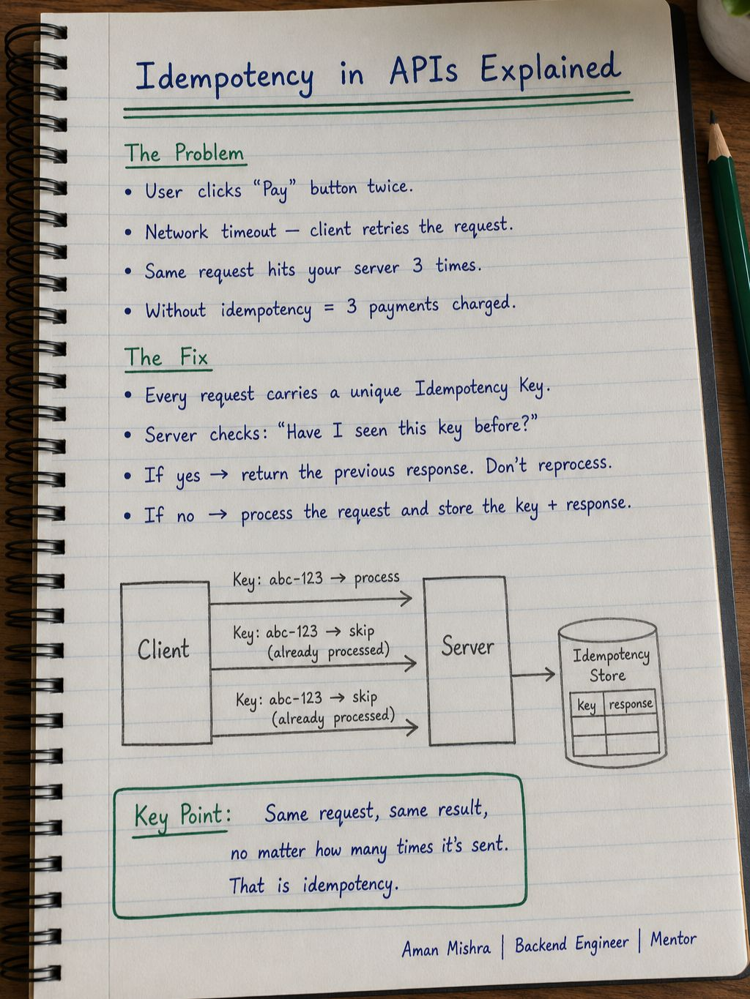

[English](README.md) · **မြန်မာ**

# Lab: inventory — user နှစ်ယောက်၊ ပစ္စည်း တစ်ခုပဲ ကျန်

Alice နဲ့ Bob က နောက်ဆုံး sneaker (`stock = 1`) ကို တစ်ပြိုင်နက် "Buy" နှိပ်တယ်။ Order တစ်ခုပဲ အောင်မြင်ရမယ်;
stock က `0` နဲ့ ဆုံးရမယ်၊ `-1` မဖြစ်ရဘူး။

**Step 1 ✅** user တစ်ယောက် order + idempotency · **Step 2** user နှစ်ယောက် တစ်ပြိုင်နက် (နောက်တစ်ဆင့်)
UI: `http://localhost:5173/labs/inventory/idempotency` · Postman: [`postman/`](postman/)

## 1. Idempotency

<a href="../../../../web/src/assets/references/idempotency/idempotency-theory.jpeg">
  
</a>

**ပြဿနာ။** Double-click ဒါမှမဟုတ် response ပျောက် (timeout) → client က retry → ကာကွယ်ချက် မရှိရင်
retry တစ်ခါ = order တစ်ခု + ပိုက်ဆံ တစ်ခါ ထပ်ဖြတ်။ `POST` က သဘာဝအရ idempotent မဟုတ်ဘူး။

**ဖြေရှင်းချက်။** Client က **ဝယ်ယူမှု attempt တစ်ခုကို key တစ်ခု** ပို့ပြီး retry မှာ key ဟောင်းကိုပဲ ပြန်ပို့တယ်။
Server: key မြင်ဖူးလား? → မြင်ဖူးရင် ပထမ ရလဒ်ကိုပဲ ပြန်ပေး၊ ဘာမှ ထပ်မလုပ်။ Key အသစ်ဆို အလုပ်လုပ်။

Key = *attempt တစ်ခု*၊ *product တစ်ခု* မဟုတ်ဘူး — sneaker တူတူ နောက်တစ်ခါ ထပ်ဝယ်ရင် key အသစ်နဲ့မို့ ဝယ်လို့ရတယ်။

<sub>Diagram: Aman Mishra</sub><br clear="right">

**Code ထဲမှာ**

| | ဘာလုပ်လဲ | ဘယ်မှာ |
|---|---|---|
| Client | attempt တစ်ခု `crypto.randomUUID()`၊ retry မှာ ပြန်သုံး (`localStorage` ထဲ သိမ်း) | `apps/web/src/labs/InventoryLab.tsx` |
| Service | ဒီ user က key သုံးပြီးသား → order ဟောင်း ပြန်ပေး၊ ဝယ်တာ ကျော် | [`inventory.service.ts#L78-L88`](inventory.service.ts#L78-L88) |
| Controller | အသစ် → **201**, replay → **200** | [`inventory.controller.ts#L45-L46`](inventory.controller.ts#L45-L46) |
| DB | `UNIQUE (user_id, idempotency_key)` — နောက်ဆုံး ကာကွယ်ချက် | [`order.entity.ts#L25`](entities/order.entity.ts#L25) |

```ts
// inventory.service.ts — stock ကို မထိခင်၊ order transaction ထဲမှာ စစ်တယ်
if (dto.idempotencyKey) {
  const existing = await em.findOne(OrderEntity, { where: { userId, idempotencyKey: dto.idempotencyKey } });
  if (existing) return { order: existing, created: false };   // replay → side effect မရှိ
}
```

Key ကို stock နုတ်တာ၊ order ဆောက်တာနဲ့ transaction တစ်ခုတည်းမှာ သိမ်းတယ် — အကုန်ဖြစ် သို့ ဘာမှမဖြစ်။
(Diagram က *Idempotency Store* သီးသန့် သုံးတယ်; ဒီမှာ key ကို `orders` row ပေါ်မှာ သိမ်းတယ်။)

**စမ်းကြည့်**

```bash
curl -s -X POST localhost:3000/api/inventory/dev/reset > /dev/null
for i in 1 2 3; do
  curl -s -o /dev/null -w "%{http_code}\n" -X POST localhost:3000/api/inventory/orders \
    -H 'Content-Type: application/json' -H 'X-User-Id: 1' \
    -d '{"productId":1,"quantity":1,"idempotencyKey":"abc-123"}'
done   # → 201, 200, 200
```

**အားနည်းချက်** (production မှာ ထပ်ထည့်တာ)
- Key တူ **တစ်ပြိုင်နက်** ပို့ → ဒုတိယက UNIQUE ကို တိုက် → 500 (order ကတော့ တစ်ခုပဲ)။ ပြင်နည်း: `ER_DUP_ENTRY` ဖမ်း။
- Key ပျောက် (reinstall, device ပြောင်း) → order အသစ်။ ပြင်နည်း: server ထုတ်တဲ့ checkout id (`PENDING` → `confirm`)။
- Key တူ body မတူ → order ဟောင်း ပြန်ရ။ ပြင်နည်း: body hash သိမ်း၊ 422 ပြန်။

**FAQ (ဆွေးနွေးခဲ့တာ)**
- *Key ကို hash နဲ့ ထုတ်လား?* မထုတ်ဘူး၊ random UUID။ Server က string နဲ့ ရှာရုံပဲ။
- *Sneaker တူတူ ထပ်ဝယ်ရင် တားမလား?* မတားဘူး — UNIQUE က `(user, key)` ပေါ်မှာ၊ `(user, product)` မဟုတ်။
  စည်းမျဉ်း: **intent အသစ် → key အသစ်၊ retry → key ဟောင်း။**
- *App kill လုပ်ရင် key ပျောက်မလား?* RAM ထဲဆို ပျောက်တယ် → disk (`localStorage`) ပေါ်သိမ်း၊ ပိုခိုင်တာက server-issued id။

**Interview Qs**
- Idempotent method? `GET`, `PUT`, `DELETE`။ `POST`/`PATCH` မဟုတ် → key လို။
- Code စစ်ပြီးသားဆို DB constraint ဘာလို့ လိုလဲ? Code check က read-then-write; concurrent request နှစ်ခုလုံး ကျော်နိုင်တယ်။
- User နှစ်ယောက် နောက်ဆုံးပစ္စည်း လုတာကို တားလား? မတားဘူး — အဲဒါ concurrency control (step 2)။

## 2. API

ခေါ်တဲ့သူ = `X-User-Id` header (1 Alice, 2 Bob) — auth step မတိုင်ခင် ယာယီ။

| | path | ရလဒ် |
|---|---|---|
| GET | `/api/inventory/products` | product (`stock`, `version`) |
| POST | `/api/inventory/orders` | `{ productId, quantity, idempotencyKey? }` → 201 အသစ် · 200 replay |
| GET | `/api/inventory/orders` | ခေါ်တဲ့ user ရဲ့ order များ |
| POST | `/api/inventory/dev/reset` | dev only: order ရှင်း၊ stock ပြန်ထား |

Errors: 401 user မပါ · 400 body မှား · 404 user/product မရှိ · 409 stock မလောက်။

## 3. Order flow (step 1)

[`createOrder`](inventory.service.ts#L67-L146)၊ transaction တစ်ခု: user? → key မြင်ဖူးလား? → stock **read** →
JS ထဲ **check** → stock အသစ် **write** → order + item insert (ဈေး snapshot)။

⚠️ Lock မပါတဲ့ read → check → write: တစ်ယောက်ဆို မှန်၊ **နှစ်ယောက် တစ်ပြိုင်နက်ဆို ပျက်** (နှစ်ယောက်လုံး `1` ဖတ်၊
`0` ရေး)။ တမင်ချန်ထား — step 2 မှာ ပြင်မယ်။ ငွေက `DECIMAL`၊ total ကို integer cents နဲ့ တွက် ([`money.ts`](money.ts))။

## 4. Schema

```
users 1──* orders 1──* order_items *──1 products
```

- `orders`: `UNIQUE(user_id, idempotency_key)` · `products`: `stock`, `version` (optimistic lock)
- CHECK `stock >= 0`, `quantity > 0`, `price >= 0`; FK `RESTRICT`
- TypeORM က MySQL မှာ `@Check` ကို ignore → CHECK တွေကို `sql/seed.sql` က ထည့်

## 5. Run it

```bash
./scripts/db.sh up mysql      # + apps/api/.env မှာ DB_DRIVER=mysql
npm run dev:api               # table ဆောက်
npm run db:seed:inventory     # user, product, CHECK
npm run dev:web
```

User `alice@lab.local` / `bob@lab.local`၊ password `password123`။ Workbench: `127.0.0.1:3306`, `lab`/`lab`။

## 6. Next (step 2): concurrency

| strategy | idea |
|---|---|
| naive (ပျက်) | `SELECT` → JS check → `UPDATE stock = ?` → oversell |
| atomic update | `UPDATE … SET stock = stock - 1 WHERE id = ? AND stock >= 1` |
| pessimistic lock | `SELECT … FOR UPDATE` |
| optimistic lock | `UPDATE … WHERE id = ? AND version = ?` |
